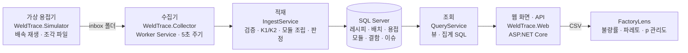

# WeldTrace

[](https://github.com/gilwon2/WeldTrace/actions/workflows/ci.yml)

전기차 배터리 모듈 **레이저 용접 라인의 MES·설비 데이터 시스템**입니다. 용접기 데이터를 주기적으로 **수집·검증해 SQL Server에 적재**하고,
모듈 단위로 **추적**하며, 출력 이상과 **레이저 출력의 점진적 열화**를 관리도로 잡아냅니다. (C# .NET 8 · SQL Server)

> 실제 공장 데이터(KAMP 배터리팩 레이저 용접, 7개월·13만 5천 회 용접)를 분석해서 규칙과 파라미터를 정했습니다.
> 원본은 재배포 허용이 명시되지 않아, 저장소에는 원본 통계를 흉내 낸 **합성 데이터**만 넣었습니다.

- **실행:** `docker compose up -d --build` → http://localhost:8080 (SQL Server · 가상 용접기 · 수집기 · 웹 화면이 함께 뜹니다)
- **문서:** [실데이터 분석](docs/analysis.md) · [검증·판정 규칙](docs/rules.md)


<sub>시연 (약 45초): 가상 용접기 데이터가 5초마다 수집되어 모듈이 늘어남 → 77가동일 전체 적재 → 출력 열화 관리도 → 불량 모듈 39스텝 역추적 → 수집 이력·데이터 이슈. CI가 실제 시스템을 띄워 자동으로 녹화합니다.</sub>

## 해결하려는 문제

배터리 모듈 하나는 레이저 용접 39회로 만들어집니다. 원본 데이터를 분석해 보니 문제는 두 가지였습니다.

1. **불량은 규칙으로 잡히지만, 데이터를 믿을 수 있어야 한다.** 스텝 공칭 출력 대비 95% 미만이면 불량이라는 규칙 하나로 라벨된 이상 용접 292건을 모두 잡았고, 7개월 정상 용접에서 오경보는 0건이었습니다. 대신 현장 데이터에는 중복 전송, 시간 역전, 결측, 파일 경계에서 잘린 모듈이 섞여 들어옵니다.
2. **진짜 위험은 서서히 떨어지는 레이저 출력이다.** 같은 조건의 용접 출력이 7개월간 약 1.3% 떨어졌습니다. 가동일 단위 EWMA 관리도는 출력이 0.3% 계단식으로 떨어진 **2022-03-17 당일**에 경보를 냈습니다. 이때는 판정 기준(95%)으로 모든 용접이 합격이었습니다.

그래서 WeldTrace는 "불량을 맞히는 모델"보다 **"설비 데이터를 믿을 수 있게 받아서, 모듈 단위로 추적하고, 열화를 일찍 알리는 시스템"**에 집중합니다.

## 주요 기능

| 기능 | 내용 |
|---|---|
| 주기 수집 | .NET Worker Service가 5초마다 inbox 폴더의 파일을 적재하고, 결과에 따라 `processed`·`failed`로 옮깁니다. |
| 가상 용접기 | 기록된 데이터를 배속 재생해 조각 파일로 내려놓는 시뮬레이터. 원본 줄을 바꾸지 않아 실제 데이터 문제가 그대로 전달됩니다. |
| 검증 | 파싱(P)·중복(D)·범위(R)·시간(T) 규칙. 제외한 행은 줄 번호와 사유로 DB에 남깁니다. |
| 멱등 적재 | 같은 파일은 다시 적재하지 않고(K1), 겹치는 파일은 새 행만 넣습니다(K2). 한 파일 = 한 트랜잭션. |
| 모듈 추적 (MES) | 39스텝 레시피 마스터 기준으로 모듈을 조립하고 판정. 파일 경계에서 잘린 모듈은 다음 파일을 기다립니다. |
| 판정 (FDC) | 미출력·출력 저하는 불량, 설정 이탈은 경고. 모듈 하나의 39회 용접을 스텝별로 역추적합니다. |
| 열화 감시 (SPC) | 가동일 평균 출력 비율에 EWMA·CUSUM 관리도, 직선 추세로 0.98·0.95 도달 예상일. |
| 연계 | 판정 결과를 [FactoryLens](https://github.com/gilwon2/FactoryLens) 업로드 형식 CSV로 내보냅니다. JSON API 제공. |

| 출력 열화 감시 | 모듈 추적 (39스텝) |
|---|---|
|  |  |

<sub>화면 캡처는 77가동일 합성 샘플을 적재한 상태입니다. 합성 데이터는 2월 말부터 열화가 시작되도록 만들었고, 관리도는 3월 2일에 첫 경보를 냅니다.</sub>

## 아키텍처



- 도메인 로직(`WeldTrace.Core`: 파싱·검증·모듈 조립·판정·관리도)은 DB와 화면을 모르는 순수 C#입니다. 그래서 손계산 기대값으로 단위 테스트합니다.
- 쓰기는 `IngestService`만, 읽기는 `QueryService`만 합니다. 화면은 조회만 합니다.
- 웹과 수집기가 동시에 시작해도 마이그레이션은 DB 잠금(`sp_getapplock`)으로 한 번만 적용됩니다.

## 실행

**전체 실행** (Docker Desktop 필요)

```bash
docker compose up -d --build        # SQL Server + 가상 용접기 + 수집기 + 웹
# 브라우저: http://localhost:8080
docker compose logs -f collector     # 5초마다 조각 파일을 적재하는 로그
docker compose down -v               # 중지 + 데이터 삭제
```

시뮬레이터는 합성 샘플을 3600배속(실제 1초 = 설비 1시간)으로 재생합니다.

**테스트** (.NET 8 SDK)

```bash
dotnet test WeldTrace.sln            # 단위 테스트 (SQL Server 통합 테스트는 자동으로 건너뜀)

# SQL Server 통합 테스트까지 (Docker의 SQL Server는 127.0.0.1:14333에 열림)
docker compose up -d sqlserver
# Windows PowerShell
$env:WELDTRACE_TEST_SQL="Server=127.0.0.1,14333;UID=sa;PWD=WeldTrace!Local2026;TrustServerCertificate=True;Encrypt=False"
# macOS·Linux
export WELDTRACE_TEST_SQL="Server=127.0.0.1,14333;UID=sa;PWD=WeldTrace!Local2026;TrustServerCertificate=True;Encrypt=False"
dotnet test WeldTrace.sln          # 100개 (Windows + Docker Desktop에서도 확인)
```

> Windows에서 `localhost`로 접속하면 IPv6(::1)로 먼저 시도해 연결 시간이 초과될 수 있어 `127.0.0.1`을 씁니다.

**합성 데이터 다시 만들기** (Python 표준 라이브러리만 사용, 시드 고정)

```bash
python tools/synth/generate.py --seed 7 --out data/sample
```

## 입력 데이터 형식

설비가 내보내는 CSV (원본 형식 그대로, 컬럼명과 시각 앞에 공백이 있어도 됩니다). `.csv`와 `.csv.gz` 모두 받습니다.

| 컬럼 | 의미 |
|---|---|
| `PageNo` | 용접 프로그램 스텝 (1~39) |
| `Speed`, `Length`, `GateOnTime` | 속도, 용접 길이(mm), 게이트 온 시간(ms) 설정 |
| `SetFrequency`, `SetDuty`, `SetPower` | 주파수, 듀티(%), 출력(%) 설정 |
| `RealPower` | 실측 출력 (W) |
| `WorkingTime` | 용접 시각 (`yyyy-MM-dd HH:mm:ss.fff`) |

## 검증·판정 규칙

| 단계 | 규칙 | 처리 |
|---|---|---|
| F 파일 | 빈 파일, 필수 컬럼 누락 | 파일 거부, 실패 배치 기록 |
| P 파싱 | 열 개수 불일치, 필수값 공백, 숫자·날짜 형식 오류 | 행 제외 |
| D 중복 | 모든 값이 같은 행 반복 / 같은 시각인데 값이 다름 | 1행만 적재+경고 / 그 시각 행 모두 제외 |
| R 범위 | 레시피에 없는 스텝, 실측 출력 0~2,500W 밖 | 행 제외 |
| T 시간 | 앞 행보다 이른 시각 | 적재하고 경고 (원본에서 6건 관측) |
| K 멱등 | 같은 파일(SHA-256) / 같은 설비·같은 시각 행 | 건너뜀 |
| 판정 | 출력 0 / 공칭 대비 95% 미만 / 설정 이탈 | 불량 / 불량 / **경고** |

설정 이탈을 불량으로 보지 않는 이유: 원본에서 설정이 바뀌어도 출력이 정상이면 검사에 합격했습니다 ([근거](docs/analysis.md#5-공정-이탈--불량)). 전체 규칙: [docs/rules.md](docs/rules.md)

## 기술 선택과 트레이드오프

| 선택 | 검토한 대안 | 고른 이유 | 감수한 점 |
|---|---|---|---|
| **C# .NET 8** | Python (FactoryLens와 같은 언어) | 공장 현장 시스템(MES·설비 PC)은 C#·.NET 비중이 큽니다. 분석은 Python(FactoryLens), 현장 시스템은 C#(WeldTrace)으로 나눠 실제 공장 구조를 따랐습니다. Worker Service·ASP.NET Core가 한 생태계에 있어 수집기·웹·도메인 로직을 한 솔루션에서 공유합니다. | 데이터 분석 라이브러리는 Python보다 빈약합니다. 관리도·추세는 직접 구현하고 손계산 테스트로 검증했습니다. |
| **SQL Server** | PostgreSQL, 시계열 DB(InfluxDB) | 국내 제조 IT·MES에서 많이 쓰는 RDBMS입니다. 3초 주기·하루 약 2천 행이면 일반 RDBMS로 충분하고, 모듈·레시피·판정 같은 관계형 추적이 핵심이라 시계열 DB보다 맞습니다. | 상용 제품이라 운영 라이선스가 필요합니다(개발·테스트는 무료 Developer 에디션 컨테이너). |
| **Dapper + 손으로 쓴 SQL** | Entity Framework Core | 적재(대량 복사·`NOT EXISTS`)와 집계(뷰·`GROUP BY`) SQL이 이 프로젝트의 핵심이라 SQL을 그대로 보여 주고 튜닝하기 쉬운 쪽을 골랐습니다. | 테이블이 바뀌면 SQL과 매핑 클래스를 직접 고쳐야 합니다. 통합 테스트가 실제 SQL Server에서 이를 잡습니다. |
| **직접 만든 마이그레이션** (T-SQL 스크립트 + 적용 기록) | EF Migrations, DbUp | 스크립트가 순수 T-SQL이라 DBA가 그대로 검토할 수 있고, 동작 원리를 설명할 수 있습니다(약 100줄). | 되돌리기(down) 스크립트가 없습니다. 운영에서는 백업 후 앞으로만 적용하는 방식을 가정합니다. |
| **SqlBulkCopy → 임시 테이블 → `INSERT ... WHERE NOT EXISTS`** | 행마다 INSERT, `MERGE` | 13만 행을 약 15~20초에 적재합니다. 유일키(설비, 시각)로 겹치는 행을 건너뛰어 재전송·겹친 파일에 안전합니다. `MERGE`는 동시성 함정이 알려져 있어 피했습니다. | 임시 테이블을 거치는 만큼 단계가 하나 늘어납니다. |
| **파일 기반 수집** (inbox 폴더) | MQTT, OPC UA 직접 연결 | 원본 데이터도 현장 시계열 DB(PLC → OPC UA 게이트웨이 → 시계열 DB)에서 CSV로 내보낸 형태였습니다. 파일은 재처리·감사(원본 보관)가 쉽습니다. | 실시간성은 수집 주기(5초)만큼 늦습니다. 적재(`IngestService`)는 바이트 묶음만 받으므로 MQTT로 바꿔도 수집 부분만 고치면 됩니다. |
| **모듈 조립은 도착 순서 기준** | 용접 시각 기준 정렬 | 시각 기준으로 정렬하면 시간이 거꾸로 찍힌 행(T1)이 다른 모듈로 섞입니다. 설비가 보낸 순서가 실제 용접 순서입니다. | 파일을 잘못된 순서로 넣으면 모듈이 깨집니다. 그래서 수집기는 파일 이름 순서(=생성 순서)로 처리합니다. |
| **잘린 모듈은 열어 두기** | 파일마다 모듈을 닫기 | 파일 경계에서 잘린 모듈을 바로 닫으면 정상 모듈이 "불완전"으로 오판됩니다. 조각 파일로 수집한 결과가 한 번에 적재한 결과와 같음을 테스트로 확인했습니다. | 마지막 모듈은 다음 데이터가 올 때까지 판정이 늦어집니다. |
| **판정은 규칙 (95% 임계값)** | 딥러닝 이상 탐지(가이드북의 N-HiTS) | 실데이터에서 규칙 하나로 라벨된 이상을 모두 잡고 오경보 0건이었습니다. 규칙은 현장 작업자가 이해하고 검증할 수 있습니다. | 라벨에 없는 새로운 유형의 이상은 규칙을 추가해야 잡힙니다. |
| **설정 이탈 = 경고** | 설정 이탈 = 불량 | 원본에서 설정이 바뀌어도 출력이 정상이면 검사에 합격했습니다. "공정 이탈"과 "불량"을 구분해야 불필요한 폐기를 막습니다. | 이탈 자체를 막는 인터록은 설비 쪽 몫으로 남깁니다. |
| **관리도는 가동일 단위** | 모듈 단위 | 모듈 단위는 하루 약 45점이라 오경보가 잦고, 실데이터에서 기준 구간에 따라 첫 경보가 3/2~3/23으로 흔들렸습니다. 하루 = 합리적 부분군으로 보면 3/17로 안정적입니다. ([분석](docs/analysis.md#3-핵심-발견-레이저-출력의-점진적-열화)) | 하루 안에 생긴 급격한 변화는 그날이 끝나야 반영됩니다. 급변은 용접 단위 판정(95%)이 즉시 잡습니다. |
| **EWMA + CUSUM 두 가지** | Shewhart(3σ) 관리도 하나 | 열화는 작고 꾸준한 이동이라 3σ 관리도로는 늦게 잡힙니다. EWMA는 작은 이동에, CUSUM은 지속적인 한 방향 이동에 강합니다. | 둘 다 기준 구간(첫 10가동일)이 정상이라는 가정에 기대며, 최소 20가동일이 필요합니다. |
| **합성 데이터 공개** | 원본 공개 | 원본 재배포 허용이 명시되지 않았습니다. 원본 통계(39스텝, 공칭 출력, 열화 패턴, 이상 유형, 가동 빈도)를 흉내 냈습니다. | 공개 저장소의 숫자는 원본과 다릅니다. 원본 결과는 [분석 문서](docs/analysis.md)에 집계 수치로만 적었습니다. |

## 프로젝트 구조

```
WeldTrace/
├─ src/
│  ├─ WeldTrace.Core/        # 도메인 로직 (DB·화면 모름): 레시피, 파싱, 검증, 모듈 조립, 판정, EWMA·CUSUM, 추세, 내보내기, 리플레이
│  ├─ WeldTrace.Data/        # SQL Server: 마이그레이션(Migrations/*.sql), 적재(IngestService), 조회(QueryService)
│  ├─ WeldTrace.Collector/   # .NET Worker Service: inbox 주기 수집
│  ├─ WeldTrace.Simulator/   # 가상 용접기 (배속 재생)
│  └─ WeldTrace.Web/         # ASP.NET Core Razor Pages + 최소 API
├─ tests/                    # xUnit 100개 (단위 70, SQL Server 통합 30)
├─ tools/
│  ├─ synth/                 # 합성 데이터 생성기 (Python 표준 라이브러리)
│  ├─ reference/             # 교차 검증용 독립 구현 (Python)
│  └─ ci/                    # CI 결과 요약, 화면 캡처 스크립트
├─ data/sample/              # 합성 샘플 (77가동일, 134,005행)
├─ docs/                     # 실데이터 분석, 검증·판정 규칙
├─ Dockerfile, docker-compose.yml
└─ .github/workflows/        # CI(빌드·테스트·종단 테스트), 화면 캡처
```

## 테스트

- **100개 통과, 빌드 경고 0** — 단위 테스트 70개는 손으로 계산한 기대값을 쓰고, 계산 과정을 테스트 주석에 적었습니다.
- **SQL Server 통합 30개** — GitHub Actions가 SQL Server 2022 컨테이너를 띄우고, 테스트마다 새 DB를 만들어 실제 SQL로 확인합니다.
- **교차 검증** — 합성 샘플 134,005행 전체를 적재한 결과(모듈 3,436개, 판정 분포, 열화 경보일)가 규칙 문서만 보고 Python으로 다시 구현한 계산기 결과와 같습니다.
- **수집 동일성** — 같은 데이터를 조각 파일 수십 개로 나눠 수집한 결과가 한 번에 적재한 결과와 같습니다.
- **종단 테스트** — CI가 `docker compose`로 전체를 띄워 가상 용접기 → 수집기 → DB → 웹 화면·API까지 데이터가 흐르는지 확인합니다.
- **회귀 테스트** — CI에서 발견한 버그(연결 풀에 남은 마이그레이션 잠금 등)를 테스트로 고정했습니다.

## 데이터 출처

> 중소벤처기업부, Korea AI Manufacturing Platform(KAMP), 전자부품(배터리팩) 예지보전 AI 데이터셋,
> 스마트제조혁신추진단(㈜인터엑스, 네스트필드㈜), 2022.12.23., www.kamp-ai.kr

원본은 KAMP에서 받을 수 있으며 저장소에는 포함하지 않았습니다. `data/sample/`은 합성 데이터입니다.

## 가정과 한계

- **설비 한 대**를 가정합니다. 스키마는 설비 ID를 갖고 있지만 화면은 `LW-01` 하나를 봅니다.
- **레시피 하나**(39스텝)를 가정합니다. 원본 7개월 동안 스텝 구성이 한 번도 바뀌지 않았습니다.
- **열화 예측은 직선 추세**입니다. 원본처럼 하락이 가속되면 실제 도달일은 더 빠릅니다. 화면에 이 전제를 표시합니다.
- **로그인이 없습니다.** 사내 망 실행을 가정합니다.
- **열린 모듈은 다음 데이터가 와야 닫힙니다.** 라인이 멈추면 마지막 모듈은 판정 대기로 남습니다.
- **배치·판정 시각은 UTC로 저장**하고 화면에서 한국 시간으로 보여 줍니다. 용접 시각은 설비가 찍은 현지 시각 그대로입니다.

## 관련 프로젝트

- [FactoryLens](https://github.com/gilwon2/FactoryLens) (Python): 생산·검사 데이터를 검증·적재하고 불량률·파레토·p 관리도로 분석합니다. WeldTrace의 `/api/export/factorylens/*.csv`를 그대로 올릴 수 있습니다. WeldTrace가 **설비 데이터**(현장 시스템)를, FactoryLens가 **품질 데이터**(분석)를 맡습니다.
